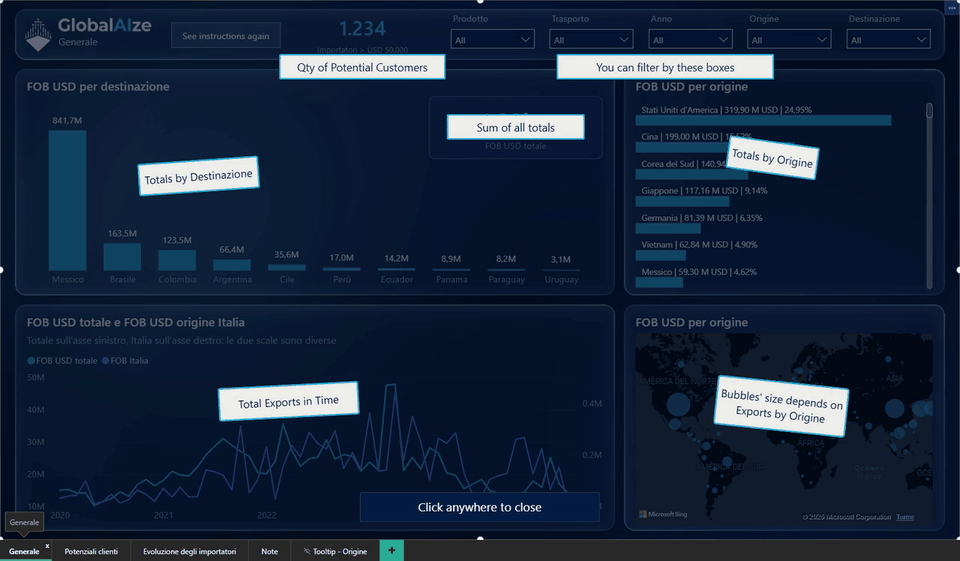
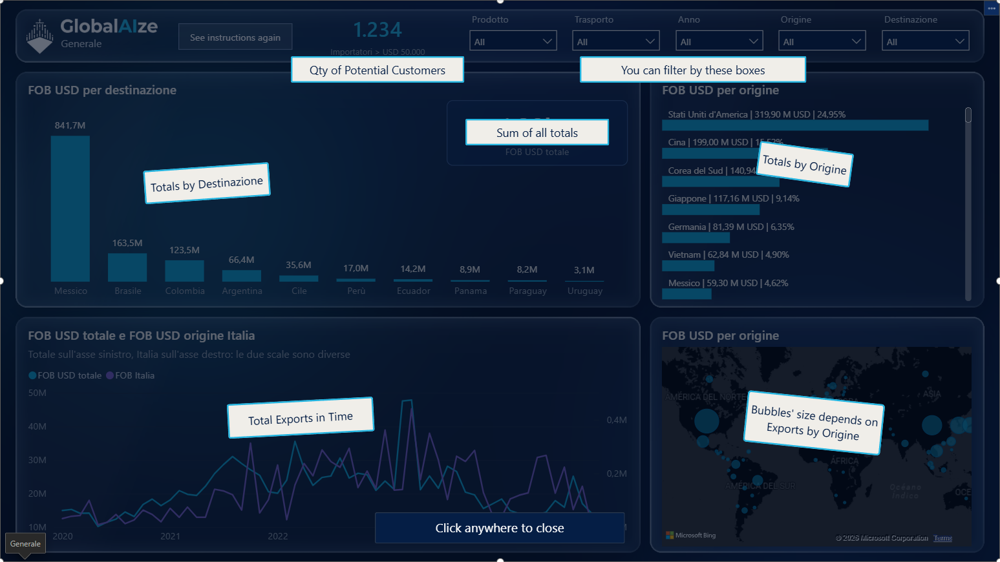
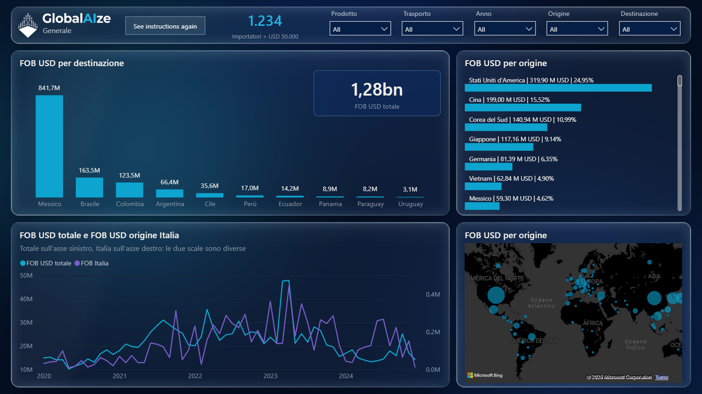
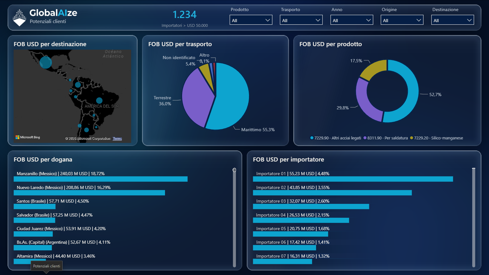
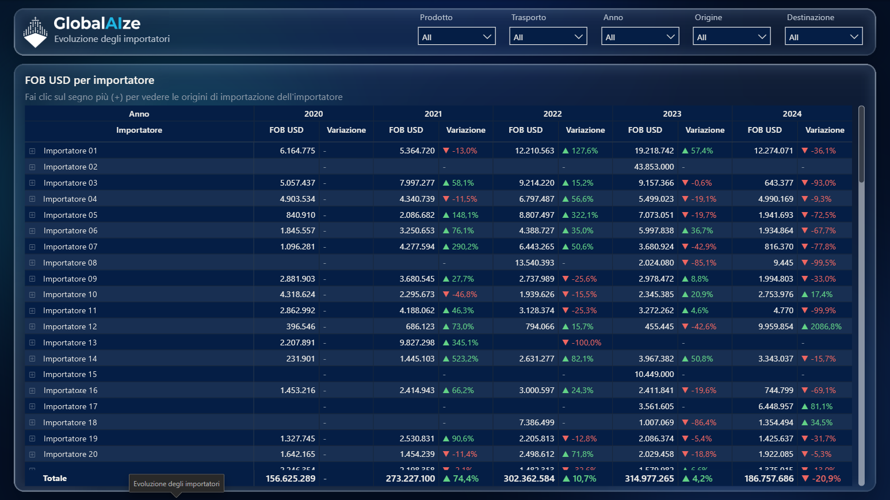
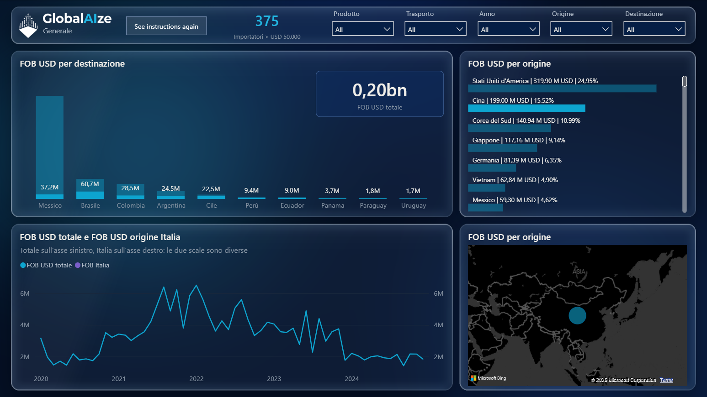
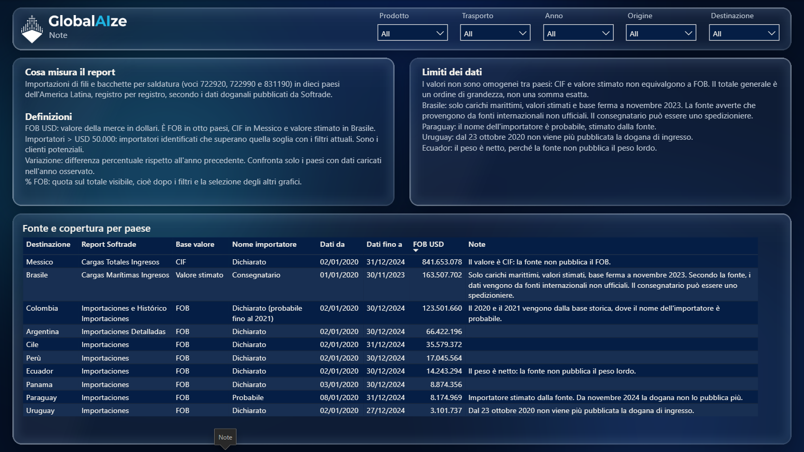
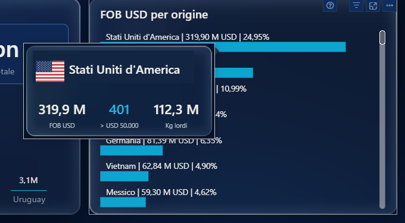
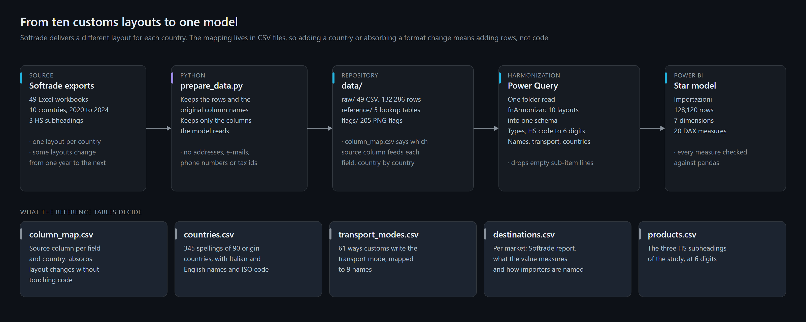
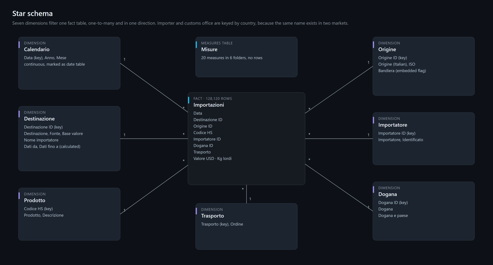

# 📊 Inteligencia de mercado de importaciones en Latam
<p>
  <a href="README.md"></a>
  <a href="README.es.md"></a>
</p>

**Quién importa alambres y varillas para soldar en América Latina, de dónde, y quién podría comprarle a Italia.**

<p align="center">
  
</p>

<p align="center"><a href="docs/Preview.mp4">▶️ Ver el recorrido en calidad completa (MP4)</a></p>

> El tablero está en italiano porque está pensado para fabricantes italianos que buscan compradores en América Latina. Se armó con registros aduaneros de Softrade de 2020 a 2024 y se publica como **Power BI Project (PBIP)**, así el modelo, el DAX y el Power Query se pueden leer acá mismo en GitHub. Los datos no se publican, y en las capturas y en el video los nombres de los importadores están reemplazados por etiquetas.

**Stack:**     

## 📋 Resumen
Un estudio de mercado de las importaciones de **alambres, varillas para soldar y aceros aleados afines** en **diez mercados de América Latina** (Argentina, Brasil, Chile, Colombia, Ecuador, México, Panamá, Paraguay, Perú y Uruguay) entre enero de 2020 y diciembre de 2024. Cubre tres subpartidas del Sistema Armonizado: **7229.20** (alambre de acero al silicomanganeso), **7229.90** (los demás alambres de acero aleado) y **8311.90** (los demás alambres, varillas y electrodos para soldar).

Los datos vienen de **Softrade**, una plataforma que publica los registros aduaneros de importación país por país: 128.120 líneas con valor, peso bruto, importador, aduana, medio de transporte y país de origen. Cada país llega con su propio formato y Power Query lleva los diez formatos a un solo modelo.

El tablero responde las preguntas de un equipo de desarrollo comercial:
- ¿Qué tamaño tiene cada mercado y cómo se mueve año a año?
- ¿Qué países lo abastecen y dónde está Italia?
- **¿Quiénes son los clientes potenciales?** ¿Qué importadores compran más de USD 50.000, por qué puertos y con qué medio de transporte?

## 📈 Hallazgos principales

| Mercado | Valor importado (USD) | Participación | Importadores con más de USD 50.000 |
|---|---:|---:|---:|
| **México** | 841,7 M | 65,6 % | 674 |
| Brasil | 163,5 M | 12,8 % | 148 |
| Colombia | 123,5 M | 9,6 % | 124 |
| Argentina | 66,4 M | 5,2 % | 112 |
| Chile | 35,6 M | 2,8 % | 38 |
| Perú | 17,0 M | 1,3 % | 51 |
| Ecuador | 14,2 M | 1,1 % | 33 |
| Panamá | 8,9 M | 0,7 % | 24 |
| Paraguay | 8,2 M | 0,6 % | 18 |
| Uruguay | 3,1 M | 0,2 % | 12 |
| **Total** | **1.282,1 M** | **100 %** | **1.234** |

- **México es dos tercios del mercado.** Su valor está informado en CIF, así que no es del todo comparable con los países FOB (ver las limitaciones), pero ningún otro mercado se le acerca.
- **El mercado creció rápido y después se enfrió:** USD 171,8 M en 2020, 288,0 M en 2021, 307,4 M en 2022, 318,7 M en 2023 y 196,1 M en 2024. Comparando solo los mercados con datos en los dos años: **+67,6 %** en 2021, **+6,7 %** en 2022, **+3,7 %** en 2023 y **-18,3 %** en 2024.
- **La oferta está concentrada:** 90 países de origen, pero Estados Unidos (25,0 %), China (15,5 %), Corea del Sur (11,0 %), Japón (9,1 %) y Alemania (6,3 %) suman el 67,0 % del valor.
- **Italia es un proveedor de nicho con espacio para crecer:** origen número 19, USD 8,46 M en cinco años (0,66 %), de 0,46 M en 2020 a 2,88 M en 2023 (1,54 M en 2024). La mayor parte va a México (4,87 M), Argentina (1,74 M) y Brasil (1,04 M), y **317 importadores identificados** ya compraron mercadería de origen italiano al menos una vez.
- **Muchos clientes, pero el dinero está concentrado:** 6.391 importadores identificados; 1.234 (19,3 %) compran más de USD 50.000 y concentran el 97,5 % del valor identificado. Los diez mayores importadores suman el 19,9 % del total. Los principales compradores de México son fabricantes de resortes y autopartes, no solo distribuidores de soldadura: una lista de prospectos se tiene que leer con eso en mente.
- **Mar y ruta dominan:** marítimo 55,3 % y terrestre 36,0 % del valor. **Por producto**, 7229.90 es el 52,7 %, 8311.90 el 29,8 % y 7229.20 el 17,5 %.

Son cifras observadas en registros aduaneros. Muestran quién importó qué, no por qué.

## 🖥️ Páginas del tablero

<table>
  <tr>
    <td width="50%"><br><b>Tutorial</b>: el informe abre con notas sobre cada visual. Un clic las cierra y <i>See instructions again</i> las vuelve a mostrar (dos marcadores).</td>
    <td width="50%"><br><b>Generale</b>: valor por destino y por origen (etiqueta arriba de cada barra), valor total, Italia contra el total en el tiempo y un mapa de burbujas de los orígenes.</td>
  </tr>
  <tr>
    <td width="50%"><br><b>Potenziali clienti</b>: mapa de destinos, medio de transporte, producto y el ranking de aduanas e importadores. Un clic en un puerto muestra los importadores que lo usan.</td>
    <td width="50%"><br><b>Evoluzione degli importatori</b>: importador por año con la variación interanual, ▲ en verde y ▼ en rojo. El (+) abre los países a los que compra cada importador.</td>
  </tr>
  <tr>
    <td width="50%"><br><b>Filtros cruzados</b>: un clic en China filtra todos los visuales: 375 importadores con más de USD 50.000 y USD 0,20 mil millones.</td>
    <td width="50%"><br><b>Note</b>: qué mide el informe, definiciones, límites de los datos y la fuente y cobertura de cada mercado.</td>
  </tr>
</table>

Todas las páginas comparten el encabezado: la cantidad de importadores con más de USD 50.000 para la selección actual y cinco segmentadores (producto, transporte, año, origen, destino). Al pasar el mouse por una barra de origen aparece un tooltip propio con la bandera del país, su valor, sus importadores con más de USD 50.000 y su peso bruto. Cada gráfico tiene un ícono de ayuda que explica qué muestra.

<p align="center">
  <br>
  <sub>Al pasar el mouse por una barra de origen aparece el tooltip propio: bandera, valor, importadores con más de USD 50.000 y peso bruto.</sub>
</p>

## 🔄 Preparación de datos (Power Query)

<p align="center">
  
</p>

Softrade exporta un Excel por consulta (país, reporte y período de hasta 12 meses). [`scripts/prepare_data.py`](scripts/prepare_data.py) convierte los 49 Excel en un CSV por país y año en `data/raw`: conserva las filas y los nombres de columna originales y **descarta toda columna que el modelo no lee** (direcciones, emails, teléfonos e identificaciones fiscales nunca llegan al repositorio). Todo lo demás pasa en Power Query, ordenado en carpetas:

| Carpeta | Consultas | Para qué |
|---|---|---|
| Parámetros | `CarpetaDatos` | Ruta de la carpeta `data`. Cambiala después de clonar. |
| Funciones | `fnLeerCsv`, `fnArmonizar`, `fnEmpresa`, `fnAduana` | Leer un CSV, llevar el formato de un país al esquema común y normalizar nombres de importadores y aduanas. |
| Origen | `ArchivosDatos`, `MapaColumnas`, `MapaTransporte`, `MapaPaises`, `Banderas`, `Operaciones` | Un solo listado de carpeta (el único acceso a disco), las tablas de referencia, las banderas y la consulta armonizada intermedia (no se carga). |
| Hechos | `Importazioni` | Tabla de hechos, una fila por línea de importación. |
| Dimensiones | `Calendario`, `Destinazione`, `Origine`, `Prodotto`, `Trasporto`, `Dogana`, `Importatore` | Tablas de búsqueda armadas desde la consulta intermedia y los archivos de referencia. |
| Auxiliares | `Misure` | Contenedor de medidas. |

**`Operaciones` paso a paso**
1. Listar `data/raw` una vez y leer cada CSV con `fnLeerCsv`. El nombre del archivo dice el país de destino y el reporte de Softrade.
2. Llevar cada archivo al esquema común con `fnArmonizar`, según `column_map.csv`.
3. Asignar tipos con la cultura `en-US` (los CSV usan punto decimal y fechas ISO).
4. Descartar las líneas de subítem que Softrade repite sin valor ni peso.
5. Cortar la posición arancelaria a los 6 dígitos del Sistema Armonizado, el nivel que comparten las diez nomenclaturas nacionales.
6. Normalizar importadores y aduanas, y llevar 61 formas de escribir el medio de transporte y 345 formas de escribir el país de origen a un nombre único, con búsquedas directas en registros en lugar de combinaciones.
7. Armar las claves de importadores y aduanas por país, porque el mismo nombre puede existir en dos mercados.

Los formatos cambian entre países y, en Panamá y Perú, entre años. En lugar de una rama por país, una tabla de mapeo dice qué columna de la fuente alimenta cada campo:

```powerquery
fnArmonizar = (tabla as table, pais as text) as table =>
    let
        Mapa = Table.SelectRows(MapaColumnas, each [country] = Text.Lower(pais) and List.Contains(Table.ColumnNames(tabla), [source_column])),
        UnaPorCampo = Table.Distinct(Mapa, {"field"}),
        Renombradas = Table.RenameColumns(Table.SelectColumns(tabla, UnaPorCampo[source_column]),
                                          List.Zip({UnaPorCampo[source_column], UnaPorCampo[field]})),
        Faltantes = List.Difference(Campos, Table.ColumnNames(Renombradas)),
        Completa = List.Accumulate(Faltantes, Renombradas, (t, campo) => Table.AddColumn(t, campo, each null))
    in
        Table.SelectColumns(Completa, Campos)
```

Sumar un formato nuevo, o un país, es agregar filas a `column_map.csv`, no tocar código.

**Controles de calidad** (cada cifra de este README se calculó por separado con pandas sobre los mismos CSV y se comparó con las medidas DAX)

| Control | Resultado |
|---|---|
| Valor total, pandas contra el modelo | USD 1.282.103.928,59 en los dos |
| Valor por destino y por año | Igual en pandas y en el modelo, al centavo |
| Importadores con más de USD 50.000, por destino | 1.234 en los dos, con la misma apertura por país |
| Filas | 132.286 líneas de origen, 128.120 cargadas al descartar los subítems vacíos |
| Países de origen | 345 formas de escribirlos llevadas a 90 países, ninguna sin mapear |
| Medio de transporte | 61 formas llevadas a 9 nombres; el 5,4 % del valor no trae medio en la fuente |
| Importador identificado | 96,2 % del valor |

## 🏗️ Modelo de datos
Esquema estrella: una tabla de hechos y siete dimensiones, relaciones de uno a varios que filtran en una sola dirección y las medidas en su propia tabla. `Calendario` es una tabla de fechas continua marcada como tal, y las banderas van incrustadas en el modelo como imágenes, así el tooltip funciona sin conexión.

<p align="center">
  
</p>

### Medidas

| Carpeta | Medidas | Qué hacen |
|---|---|---|
| 1. Base | `FOB USD`, `Kg lordi`, `FOB Italia` | Piezas básicas. |
| 2. Quote | `% FOB`, `% Kg`, `% FOB Italia` | Participaciones sobre lo que está a la vista (`ALLSELECTED`), así siguen a los filtros y los clics. |
| 3. Clienti potenziali | `Importatori > USD 50.000`, `Importatori` | Importadores identificados por encima del umbral para la selección actual. |
| 4. Tempo | `FOB anno precedente`, `Variazione %`, `Variazione`, `Variazione colore` | Variación interanual como número, como texto con flecha y su color. |
| 5. Etichette | `Posizione etichetta`, `Etichetta origine`, `Etichetta dogana`, `Etichetta importatore` | Etiquetas que se ven arriba de las barras. |
| 6. Tooltip | `Bandiera selezionata`, `Origine selezionata`, `FOB USD (M)`, `Kg lordi (M)` | Contenido del tooltip de origen. |

Los registros de Brasil terminan en noviembre de 2023. Una variación interanual simple leería eso como un derrumbe en 2024, así que la variación solo compara los destinos con datos cargados en el año que se mira:

```dax
Variazione % =
VAR AnnoCorrente = MAX ( Calendario[Anno] )
VAR Comparabili = FILTER ( Destinazione, YEAR ( Destinazione[Dati fino a] ) >= AnnoCorrente )
VAR Attuale = CALCULATE ( [FOB USD], Comparabili )
VAR Precedente = CALCULATE ( [FOB anno precedente], Comparabili )
RETURN
    IF ( HASONEVALUE ( Calendario[Anno] ) && Precedente > 0, DIVIDE ( Attuale - Precedente, Precedente ) )
```

La matriz la muestra como `▲ 15,2%` o `▼ -19,7%` en verde o rojo, y con un guion cuando no hay año anterior con el que comparar. Para poner la etiqueta arriba de cada barra, los gráficos de barras llevan una segunda serie que siempre vale cero (`Posizione etichetta`) y que carga el texto.

Cada tabla, columna, medida y paso de Power Query, con su descripción, se puede revisar en [`Latam_Imports.SemanticModel/definition`](Latam_Imports.SemanticModel/definition) (formato TMDL).

## ⚠️ Alcance y limitaciones
- **El valor no es el mismo en todos lados.** Es FOB en ocho mercados, **CIF en México** (la fuente no publica el FOB) y un **valor estimado en Brasil**. El tablero mantiene la etiqueta "FOB USD" para todos; el total general es un orden de magnitud, no una suma FOB exacta.
- **Brasil:** solo carga marítima, de manifiestos, con valores estimados, y la base de la fuente termina en noviembre de 2023, así que 2024 no tiene datos de Brasil. Softrade aclara que estos datos vienen de fuentes internacionales no oficiales, y la empresa que figura es el consignatario, que puede ser un despachante o forwarder.
- **Nombres de importadores:** probables (estimados por la fuente) en Paraguay y en Colombia para 2020 y 2021. Las líneas sin nombre de importador (3,8 % del valor) cuentan en todos los totales pero no en los rankings de importadores.
- **Productos:** las subpartidas son más amplias que el alambre para soldar. 7229.90 también incluye alambre de acero aleado para resortes y otros usos; por eso hay fabricantes de resortes entre los principales importadores.
- **Uruguay** dejó de publicar la aduana el 23 de octubre de 2020, y **Ecuador** publica peso neto en lugar de peso bruto.
- **Dos escalas en un gráfico:** el gráfico de líneas muestra el total en el eje izquierdo e Italia en el derecho, como pedía el diseño original. Su subtítulo lo aclara.

## 📂 Estructura del repositorio

```
├── Latam_Imports.pbip                          # el tablero como Power BI Project (código fuente, sin datos)
├── Latam_Imports.SemanticModel/definition/     # modelo como código (TMDL): tablas, medidas, Power Query
├── Latam_Imports.Report/definition/            # informe como código (PBIR): páginas, visuales y marcadores
├── data/raw/                                   # no se publica: los datos de Softrade son de uso de la cuenta (ver Cómo abrirlo)
├── data/reference/                             # mapa de columnas, países, transportes, destinos, productos
├── data/flags/                                 # 205 banderas (flag-icons, licencia MIT)
├── scripts/prepare_data.py                     # de los Excel de Softrade a data/raw
├── Preview.gif                                 # recorrido del tablero (arriba)
├── docs/Preview.mp4                            # recorrido en calidad completa
├── docs/img/                                   # imágenes del README: páginas, flujo de datos y modelo
└── LICENSE
```

## ▶️ Cómo abrirlo

El tablero se publica como Power BI Project: el modelo (TMDL) y el informe (PBIR) como archivos de texto, sin los datos. Para verlo con cifras, cargá tus propias descargas.

1. Cloná el repositorio (o descargalo como ZIP).
2. Armá `data/raw` con tus propias descargas de Softrade, pasándolas por [`scripts/prepare_data.py`](scripts/prepare_data.py). Los datos crudos no se publican porque Softrade los licencia a cada cuenta.
3. Abrí `Latam_Imports.pbip` con una versión reciente de Power BI Desktop.
4. Andá a **Inicio > Transformar datos > Editar parámetros** y poné en `CarpetaDatos` la ruta completa de la carpeta `data` en tu computadora (terminada en `\`).
5. Hacé clic en **Actualizar**.

Los mapas de burbujas usan Bing Maps: si se ven en blanco, habilitá los visuales de mapa en **Archivo > Opciones y configuración > Opciones > Seguridad**.

## 👤 Autor
**Mauro E. Martinez**, [GlobalAIze](https://www.globalaize.com). Fuente de datos: [Softrade](https://www.softrade.info). Banderas: [flag-icons](https://github.com/lipis/flag-icons) de Panayiotis Lipiridis, licencia MIT (ver `data/flags/LICENSE`).

Los archivos del proyecto se publican bajo la [licencia MIT](LICENSE). Los datos siguen sujetos a los términos de su fuente.
