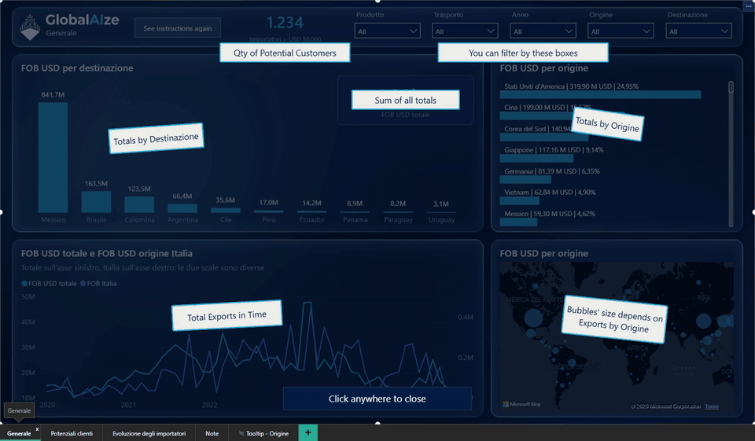
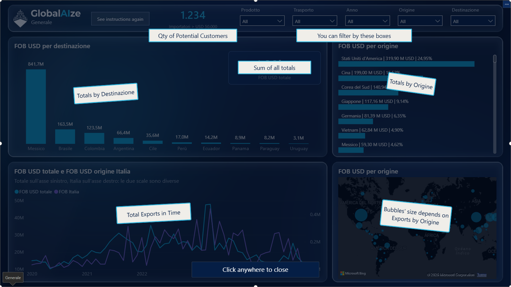
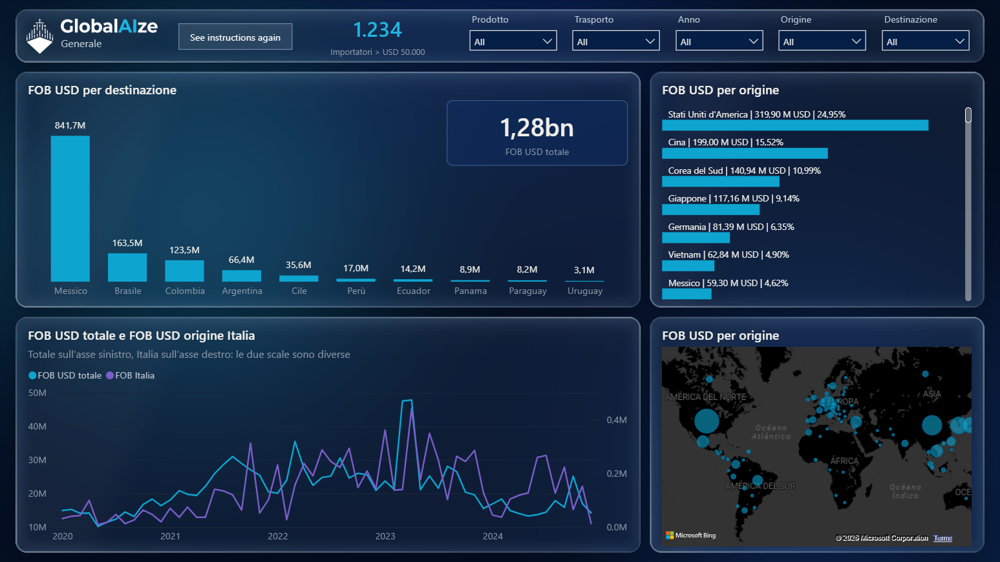
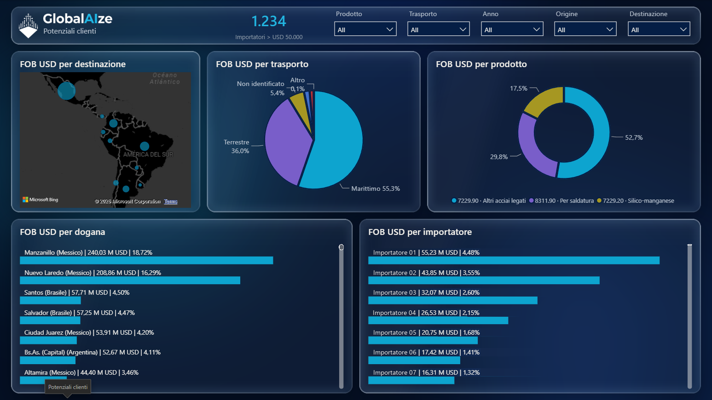
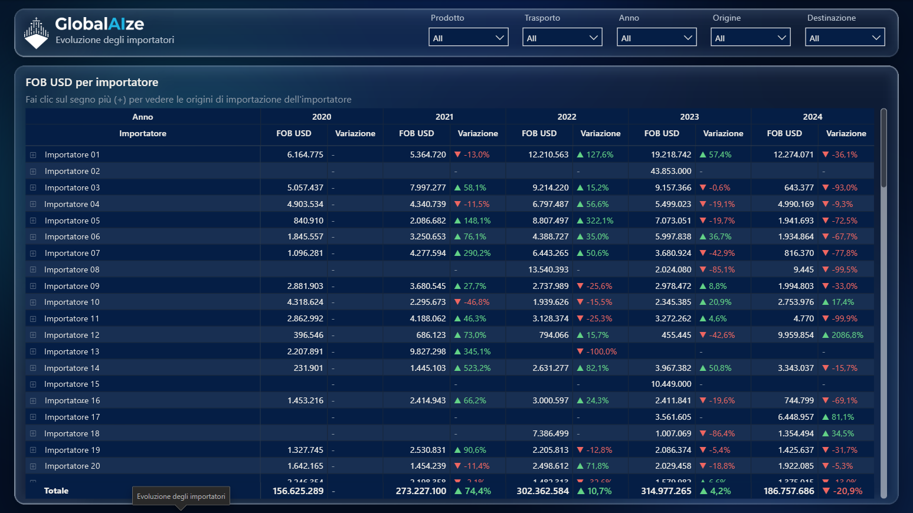
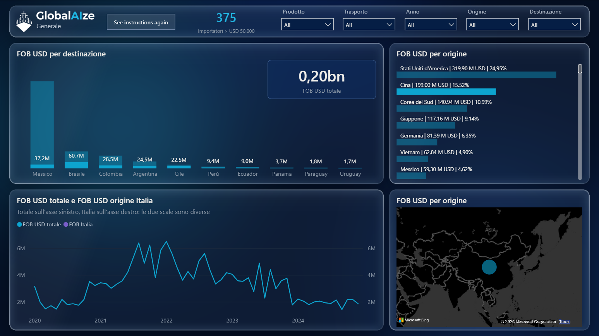
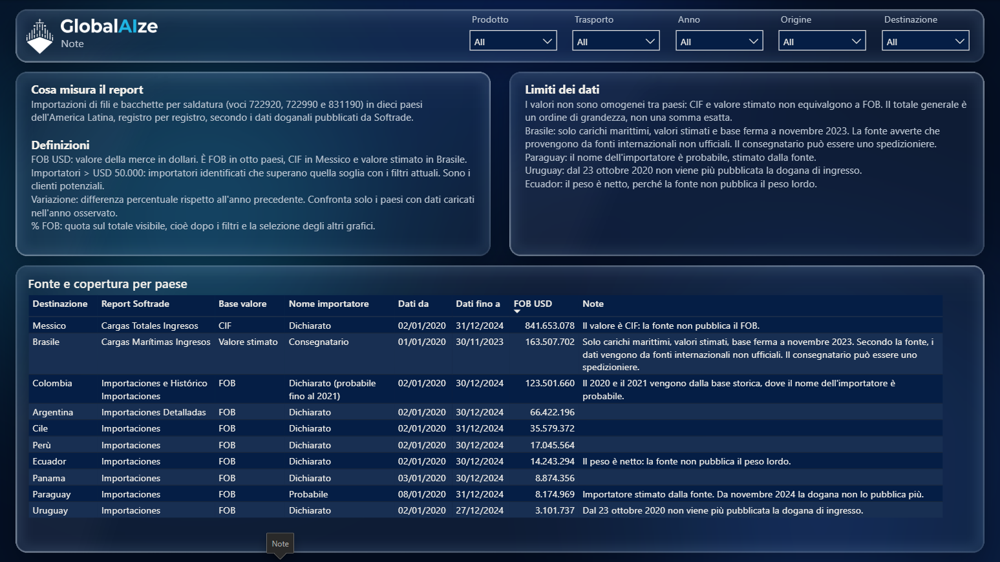
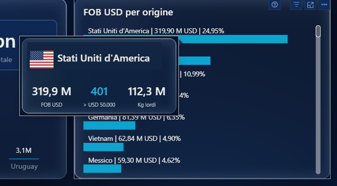
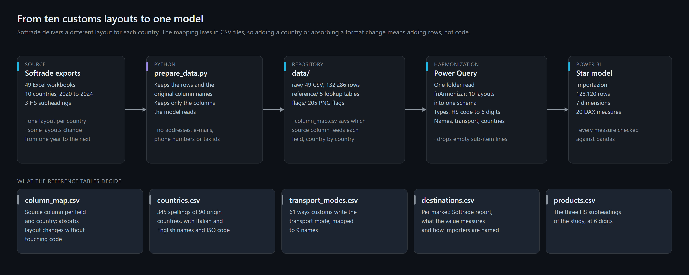
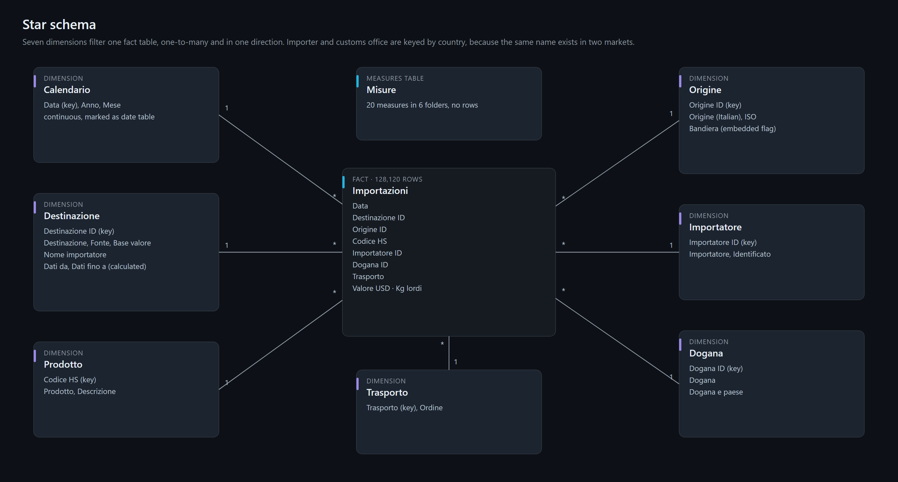

# 📊 Latam Imports Market Intelligence
<p>
  <a href="README.md"></a>
  <a href="README.es.md"></a>
</p>

**Who imports welding wire and rods in Latin America, from where, and who could buy from Italy.**

<p align="center">
  
</p>

<p align="center"><a href="docs/Preview.mp4">▶️ Watch the walkthrough in full quality (MP4)</a></p>

> The dashboard is in Italian because it is designed for Italian manufacturers looking for buyers in Latin America. It was built with Softrade customs records for 2020 to 2024 and is published as a **Power BI Project (PBIP)**, so the model, the DAX and the Power Query code can be read right here on GitHub. The data itself is not published, and importer names in the screenshots and the video are replaced with labels.

**Stack:**     

## 📋 Executive Summary
A market study of imports of **welding wire, rods and related alloy steel** into **ten Latin American markets** (Argentina, Brazil, Chile, Colombia, Ecuador, Mexico, Panama, Paraguay, Peru and Uruguay) from January 2020 to December 2024. It covers three HS subheadings: **7229.20** (silico-manganese steel wire), **7229.90** (other alloy steel wire) and **8311.90** (other welding wire, rods and electrodes).

The data comes from **Softrade**, a platform that publishes customs import records country by country: 128,120 import lines with value, gross weight, importer, customs office, transport mode and country of origin. Each country arrives in its own layout, and Power Query brings the ten layouts into one model.

The dashboard was built to answer the questions of a business development team:
- How big is each market, and how is it moving year after year?
- Which countries supply it, and where does Italy stand?
- **Who are the potential customers:** which importers buy more than USD 50,000, through which ports and by which transport mode?

## 📈 Key Findings

| Market | Import value (USD) | Share | Importers above USD 50,000 |
|---|---:|---:|---:|
| **Mexico** | 841.7 M | 65.6% | 674 |
| Brazil | 163.5 M | 12.8% | 148 |
| Colombia | 123.5 M | 9.6% | 124 |
| Argentina | 66.4 M | 5.2% | 112 |
| Chile | 35.6 M | 2.8% | 38 |
| Peru | 17.0 M | 1.3% | 51 |
| Ecuador | 14.2 M | 1.1% | 33 |
| Panama | 8.9 M | 0.7% | 24 |
| Paraguay | 8.2 M | 0.6% | 18 |
| Uruguay | 3.1 M | 0.2% | 12 |
| **Total** | **1,282.1 M** | **100%** | **1,234** |

- **Mexico is two thirds of the market.** Its value is reported at CIF, so it is not strictly comparable with the FOB countries (see the limitations below), but no other market comes close.
- **The market grew fast and then cooled:** USD 171.8 M in 2020, 288.0 M in 2021, 307.4 M in 2022, 318.7 M in 2023 and 196.1 M in 2024. Comparing only the markets with data in both years: **+67.6%** in 2021, **+6.7%** in 2022, **+3.7%** in 2023 and **-18.3%** in 2024.
- **Supply is concentrated:** 90 countries of origin, but the United States (25.0%), China (15.5%), South Korea (11.0%), Japan (9.1%) and Germany (6.3%) supply 67.0% of the value.
- **Italy is a niche supplier with room to grow:** 19th origin, USD 8.46 M in five years (0.66%), rising from 0.46 M in 2020 to 2.88 M in 2023 (1.54 M in 2024). Most of it goes to Mexico (4.87 M), Argentina (1.74 M) and Brazil (1.04 M), and **317 identified importers** already bought Italian-origin product at least once.
- **The customer base is wide but the money is concentrated:** 6,391 identified importers, of which 1,234 (19.3%) buy more than USD 50,000 and hold 97.5% of the identified value. The ten largest importers alone account for 19.9% of the total. The top buyers in Mexico are spring and auto-parts manufacturers, not only welding distributors: a lead list should be read with that in mind.
- **Sea and road dominate:** maritime 55.3% and land 36.0% of the value. **By product**, 7229.90 is 52.7%, 8311.90 29.8% and 7229.20 17.5%.

These are observed figures in customs records. They show who imported what, not why.

## 🖥️ Dashboard Pages

<table>
  <tr>
    <td width="50%"><br><b>Guided tour</b>: the report opens with notes on top of each visual. One click closes them, and <i>See instructions again</i> brings them back (two bookmarks).</td>
    <td width="50%"><br><b>Generale</b>: value by destination and by origin (label above each bar), total value, Italy against the total over time and a bubble map of origins.</td>
  </tr>
  <tr>
    <td width="50%"><br><b>Potenziali clienti</b>: destination map, transport mode, product, and the ranking of customs offices and importers. Clicking a port shows the importers that use it.</td>
    <td width="50%"><br><b>Evoluzione degli importatori</b>: importer by year with the year-over-year change, ▲ in green and ▼ in red. The (+) opens the countries each importer buys from.</td>
  </tr>
  <tr>
    <td width="50%"><br><b>Cross-filtering</b>: clicking China filters every visual: 375 importers above USD 50,000 and USD 0.20 bn.</td>
    <td width="50%"><br><b>Note</b>: what the report measures, definitions, data limits and the source and coverage of each market.</td>
  </tr>
</table>

Every page shares the same header: the number of importers above USD 50,000 for the current selection and five slicers (product, transport, year, origin, destination). Hovering an origin bar opens a custom tooltip with the country's flag, its value, its importers above USD 50,000 and its gross weight. Each chart has a help icon that explains what it shows.

<p align="center">
  <br>
  <sub>Hovering an origin bar opens the custom tooltip: flag, value, importers above USD 50,000 and gross weight.</sub>
</p>

## 🔄 Data Preparation (Power Query)

<p align="center">
  
</p>

Softrade exports one Excel workbook per query (country, report and period of up to 12 months). [`scripts/prepare_data.py`](scripts/prepare_data.py) turns the 49 workbooks into one CSV per country and year in `data/raw`, keeping the rows and the original column names, and **dropping every column the model does not read** (addresses, e-mails, phone numbers and tax ids never reach the repository). Everything else happens in Power Query, organized in folders:

| Folder | Queries | Purpose |
|---|---|---|
| Parámetros | `CarpetaDatos` | Path of the `data` folder. Change it after cloning. |
| Funciones | `fnLeerCsv`, `fnArmonizar`, `fnEmpresa`, `fnAduana` | Read a CSV, map a country's layout to the common schema, and normalize importer and customs office names. |
| Origen | `ArchivosDatos`, `MapaColumnas`, `MapaTransporte`, `MapaPaises`, `Banderas`, `Operaciones` | One folder listing (the only disk access), the reference tables, the flags and the harmonized staging query (not loaded). |
| Hechos | `Importazioni` | Fact table, one row per import line. |
| Dimensiones | `Calendario`, `Destinazione`, `Origine`, `Prodotto`, `Trasporto`, `Dogana`, `Importatore` | Lookup tables built from the staging query and the reference files. |
| Auxiliares | `Misure` | Measures container. |

**`Operaciones` step by step**
1. List `data/raw` once and read each CSV with `fnLeerCsv`. The file name gives the destination country and the Softrade report.
2. Bring each file to the common schema with `fnArmonizar`, driven by `column_map.csv`.
3. Set types with the `en-US` culture (the CSVs use a decimal point and ISO dates).
4. Drop the sub-item lines Softrade repeats with no value and no weight.
5. Cut the tariff code to its 6-digit HS subheading, the level the ten national nomenclatures share.
6. Normalize importers and customs offices, and map 61 spellings of the transport mode and 345 spellings of the country of origin to one name each, with direct record lookups instead of merges.
7. Key importers and customs offices by country, because the same name can exist in two markets.

The layouts change between countries and, in Panama and Peru, between years. Instead of one branch per country, a mapping table says which source column feeds each field:

```powerquery
fnArmonizar = (tabla as table, pais as text) as table =>
    let
        Mapa = Table.SelectRows(MapaColumnas, each [country] = Text.Lower(pais) and List.Contains(Table.ColumnNames(tabla), [source_column])),
        UnaPorCampo = Table.Distinct(Mapa, {"field"}),
        Renombradas = Table.RenameColumns(Table.SelectColumns(tabla, UnaPorCampo[source_column]),
                                          List.Zip({UnaPorCampo[source_column], UnaPorCampo[field]})),
        Faltantes = List.Difference(Campos, Table.ColumnNames(Renombradas)),
        Completa = List.Accumulate(Faltantes, Renombradas, (t, campo) => Table.AddColumn(t, campo, each null))
    in
        Table.SelectColumns(Completa, Campos)
```

Absorbing a new layout, or adding a country, means adding rows to `column_map.csv`, not editing code.

**Data quality checks** (every figure in this README was computed independently with pandas on the same CSV files and matched against the DAX measures)

| Check | Result |
|---|---|
| Total value, pandas vs. model | USD 1,282,103,928.59 in both |
| Value by destination and by year | Equal in pandas and in the model, to the cent |
| Importers above USD 50,000, by destination | 1,234 in both, with the same split by country |
| Rows | 132,286 source lines, 128,120 loaded after dropping empty sub-item lines |
| Countries of origin | 345 spellings mapped to 90 countries, none left unmapped |
| Transport mode | 61 spellings mapped to 9 names; 5.4% of the value has no mode in the source |
| Importer identified | 96.2% of the value |

## 🏗️ Data Model
Star schema: one fact table and seven dimensions, one-to-many relationships filtering in one direction, and the measures in their own table. `Calendario` is a continuous date table marked as such, and the flags are embedded in the model as images, so the tooltip works offline.

<p align="center">
  
</p>

### Measures

| Folder | Measures | What they do |
|---|---|---|
| 1. Base | `FOB USD`, `Kg lordi`, `FOB Italia` | Building blocks. |
| 2. Quote | `% FOB`, `% Kg`, `% FOB Italia` | Shares of what is on screen (`ALLSELECTED`), so they follow filters and clicks. |
| 3. Clienti potenziali | `Importatori > USD 50.000`, `Importatori` | Identified importers above the threshold for the current selection. |
| 4. Tempo | `FOB anno precedente`, `Variazione %`, `Variazione`, `Variazione colore` | Year-over-year change as a number, as text with an arrow, and its colour. |
| 5. Etichette | `Posizione etichetta`, `Etichetta origine`, `Etichetta dogana`, `Etichetta importatore` | Labels shown above the bars. |
| 6. Tooltip | `Bandiera selezionata`, `Origine selezionata`, `FOB USD (M)`, `Kg lordi (M)` | Contents of the origin tooltip. |

Brazil's records stop in November 2023. A plain year-over-year measure would read that as a collapse in 2024, so the change only compares destinations with data loaded in the year being viewed:

```dax
Variazione % =
VAR AnnoCorrente = MAX ( Calendario[Anno] )
VAR Comparabili = FILTER ( Destinazione, YEAR ( Destinazione[Dati fino a] ) >= AnnoCorrente )
VAR Attuale = CALCULATE ( [FOB USD], Comparabili )
VAR Precedente = CALCULATE ( [FOB anno precedente], Comparabili )
RETURN
    IF ( HASONEVALUE ( Calendario[Anno] ) && Precedente > 0, DIVIDE ( Attuale - Precedente, Precedente ) )
```

The matrix shows it as `▲ 15,2%` or `▼ -19,7%` with a green or red font, and a dash when there is no previous year to compare with. To show a label above each bar, the bar charts carry a second series that is always zero (`Posizione etichetta`) and holds the text label.

Every table, column, measure and Power Query step, with its description, can be reviewed in [`Latam_Imports.SemanticModel/definition`](Latam_Imports.SemanticModel/definition) (TMDL format).

## ⚠️ Scope and Limitations
- **The value is not the same everywhere.** It is FOB in eight markets, **CIF in Mexico** (the source does not publish FOB) and an **estimated value in Brazil**. The dashboard keeps the label "FOB USD" for all of them; the grand total is an order of magnitude, not an exact FOB sum.
- **Brazil:** maritime cargo only, from cargo manifests, with estimated values, and the source's database ends in November 2023, so 2024 has no Brazilian data. Softrade notes that this data comes from non-official international sources, and the named company is the consignee, which can be a freight forwarder.
- **Importer names:** probable (inferred by the source) in Paraguay and in Colombia for 2020 and 2021. Lines with no importer name (3.8% of the value) count in every total but not in the importer rankings.
- **Products:** HS subheadings are broader than welding wire. 7229.90 also covers alloy steel wire for springs and other uses, which is why spring makers rank among the top importers.
- **Uruguay** stopped publishing the customs office on 23 October 2020, and **Ecuador** publishes net weight instead of gross weight.
- **Two scales in one chart:** the line chart shows the total on the left axis and Italy on the right axis, as the original design asked. Its subtitle says so.

## 📂 Repository Structure

```
├── Latam_Imports.pbip                          # the dashboard as a Power BI Project (source code, no data)
├── Latam_Imports.SemanticModel/definition/     # data model as code (TMDL): tables, measures, Power Query
├── Latam_Imports.Report/definition/            # report as code (PBIR): pages, visuals and bookmarks
├── data/raw/                                   # not published: Softrade data is licensed per account (see How to Open It)
├── data/reference/                             # column map, countries, transport modes, destinations, products
├── data/flags/                                 # 205 flags (flag-icons, MIT License)
├── scripts/prepare_data.py                     # Softrade Excel exports to data/raw
├── Preview.gif                                 # dashboard walkthrough (embedded above)
├── docs/Preview.mp4                            # dashboard walkthrough in full quality
├── docs/img/                                   # README images: pages, data flow and data model
└── LICENSE
```

## ▶️ How to Open It

The dashboard is published as a Power BI Project: the model (TMDL) and the report (PBIR) as text files, without the data. To see it with figures, load your own exports.

1. Clone the repository (or download it as a ZIP).
2. Build `data/raw` from your own Softrade exports with [`scripts/prepare_data.py`](scripts/prepare_data.py). The raw data is not published because Softrade licenses it to each account.
3. Open `Latam_Imports.pbip` with a recent version of Power BI Desktop.
4. Go to **Home > Transform data > Edit parameters** and set `CarpetaDatos` to the full path of the `data` folder on your computer (ending with `\`).
5. Click **Refresh**.

The bubble maps use Bing Maps: if they show up blank, enable map visuals in **File > Options and settings > Options > Security**.

## 👤 Author
**Mauro E. Martinez**, [GlobalAIze](https://www.globalaize.com). Data source: [Softrade](https://www.softrade.info). Flags: [flag-icons](https://github.com/lipis/flag-icons) by Panayiotis Lipiridis, MIT License (see `data/flags/LICENSE`).

The project files are released under the [MIT License](LICENSE). The data remains subject to the terms of its source.
